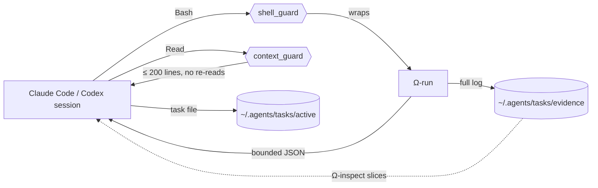

<h1 align="center">
  
  omega
</h1>

<p align="center">
  A small, versioned agent setup for Claude Code, Codex and Mistral Vibe that keeps the context window clean.
</p>

## Why

Long agent sessions degrade when the context fills with instructions nobody needs, full command
logs and files read twice. omega keeps the always-loaded part small and moves the rest out of the
context:

- **One short instruction file** (`AGENTS.md`) shared by Claude Code and Codex.
- **Three workers** — `scout`, `coder`, `architect` — instead of a crowd of roles.
- **Skills loaded on demand**: only their one-line description is in the context until a task matches.
- **Command output on disk**: `Ω-run` stores the full log as evidence and returns a bounded summary.
- **Guard hooks** that wrap shell commands, bound large reads and refuse re-reads of unchanged lines.
- **Progress pages** for long missions: one static page per task and a single hub to follow them all in one browser tab.

On reproducible tool workloads (large reads, long build logs), the model receives **86 % fewer
tokens** from its tools without losing the information it needs. End to end, on long headless
sessions against plain Claude Code (Opus 5.5, same 9 tasks, all solved by both), the full omega
setup (tools and instructions) used half the turns and a third less wall time; cost was 24 % lower
on average, but with 3 repetitions that cost gap is not yet statistically solid. With the same
instructions on both sides the cost is equal (+8 %, within noise): the end-to-end saving comes from
the instructions; the tools bound large outputs ([benchmark](docs/benchmark.md)).

## How it works



## Quick start

Requirements: Linux, Python 3.12, a Rust toolchain (`cargo`), Claude Code and/or Codex.

```sh
git clone git@github.com:mcaniot/Omega.git && cd Omega
python3 install.py            # dry run: shows what would change, touches nothing
python3 install.py --apply    # link sources, build and install the binaries, register hooks
omega --version               # → omega 1.1.0
```

Keep `~/.local/bin` on `PATH`, then restart Claude Code and start a new Codex conversation.
Anything the installer does not own is reported as `CONFLICT` and left untouched. Details:
[Installation](docs/installation.md).

## What gets installed

| Source | Role |
| --- | --- |
| `AGENTS.md` | Global instructions shared by Claude Code and Codex |
| `agents/` | The three workers: `scout`, `coder`, `architect` |
| `skills/` | Procedures loaded on demand (robotics, debugging, code review, C++, retro, progress pages, …) |
| `rust/` | Native binaries: `Ω-run`, `Ω-inspect`, guards, `omega` CLI |
| `prompts/`, `output-styles/` | Compact response prompts for Codex and Claude Code |
| `themes/` | Optional Omega theme for the Claude desktop app (`install.py --omega-theme`) |
| `systemd/` | Optional daily maintenance timers |

Where each piece lands under `~/.agents`, `~/.claude` and `~/.codex`:
[Architecture](docs/architecture.md#layout).

## Everyday use

```sh
'Ω-run' --timeout 120 -- python3 -m pytest     # run a command, full log kept as evidence
'Ω-inspect' EVIDENCE --search error --lines 20 # read only the slice you need
'Ω-resume' TASK                                 # pick up a task from its task file
'Ω-optimize'                                    # audit recent sessions for context waste
```

Agents call these themselves; the guards rewrite plain shell commands to `Ω-run`. The ASCII names
(`omega-run`, `omega resume`, `omega optimize`, …) keep working.

### Follow long missions

A mission expected to run more than about an hour unattended keeps a progress page, created by its
agent without being asked (`progress-page` skill). Keep one tab open on the hub:

```text
file://$HOME/.agents/progress/index.html
```

It groups every mission by urgency — waiting for your decision (counted in the tab title), blocked,
active, finished — with the latest visual, per-step progress, last change and the age of the last
update; a task silent for 2 h is flagged. Each card opens the task page: steps, journal, decisions
and an image viewer. Pages reload themselves (pausable), work offline from `file://`, follow light
or dark mode, and survive `/clear` and handoffs: the task file links the page, and a new agent is
logged as a takeover.

## Documentation

| I want to… | Read |
| --- | --- |
| Install, update or schedule maintenance | [Installation](docs/installation.md) |
| Look up a command and its options | [Commands](docs/commands.md) |
| Understand what each hook allows or blocks | [Hooks](docs/hooks.md) |
| Audit sessions and read the report | [`omega optimize`](docs/optimize.md) |
| Understand the layout, agents and context rules | [Architecture](docs/architecture.md) |
| Run the tests or cut a release | [Development](docs/development.md) |
| See what omega saves, per tool and end to end | [Benchmark](docs/benchmark.md) |

## Versions

omega follows [Semantic Versioning](https://semver.org/). Changes are listed in
[CHANGELOG.md](CHANGELOG.md); each release is a `vX.Y.Z` tag with a GitHub Release.

## License

[MIT](LICENSE)
