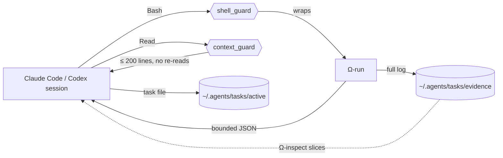

<h1 align="center">
  
  omega
</h1>

<p align="center">
  A small, versioned agent setup for Claude Code and Codex that keeps the context window clean.
</p>

## Why

Long agent sessions degrade when the context fills with instructions nobody needs, full command
logs and files read twice. omega keeps the always-loaded part small and moves the rest out of the
context:

- **One short instruction file** (`AGENTS.md`) shared by Claude Code and Codex.
- **Three workers** — `scout`, `coder`, `architect` — instead of a crowd of roles.
- **Skills loaded on demand**: only their one-line description is in the context until a task matches.
- **Command output on disk**: `Ω-run` stores the full log as evidence and returns a bounded summary.
- **Guard hooks** that wrap shell commands, bound large reads and refuse re-reads of unchanged lines.

## How it works



## Quick start

Requirements: Linux, Python 3.12, a Rust toolchain (`cargo`), Claude Code and/or Codex.

```sh
git clone git@github.com:mcaniot/Omega.git && cd Omega
python3 install.py            # dry run: shows what would change, touches nothing
python3 install.py --apply    # link sources, build and install the binaries, register hooks
omega --version               # → omega 1.0.0
```

Keep `~/.local/bin` on `PATH`, then restart Claude Code and start a new Codex conversation.
Anything the installer does not own is reported as `CONFLICT` and left untouched. Details:
[Installation](docs/installation.md).

## Everyday use

```sh
'Ω-run' --timeout 120 -- python3 -m pytest     # run a command, full log kept as evidence
'Ω-inspect' EVIDENCE --search error --lines 20 # read only the slice you need
omega resume TASK                               # pick up a task from its task file
omega optimize                                  # audit recent sessions for context waste
```

Agents call these themselves; the guards rewrite plain shell commands to `Ω-run`.

## Documentation

| I want to… | Read |
| --- | --- |
| Install, update or schedule maintenance | [Installation](docs/installation.md) |
| Look up a command and its options | [Commands](docs/commands.md) |
| Understand what each hook allows or blocks | [Hooks](docs/hooks.md) |
| Audit sessions and read the report | [`omega optimize`](docs/optimize.md) |
| Understand the layout, agents and context rules | [Architecture](docs/architecture.md) |
| Run the tests or cut a release | [Development](docs/development.md) |
| See the measurements behind the design | [Context reliability](docs/context-reliability.md) |

## Versions

omega follows [Semantic Versioning](https://semver.org/). Changes are listed in
[CHANGELOG.md](CHANGELOG.md); each release is a `vX.Y.Z` tag with a GitHub Release.

The previous Omega project (memory, code graph, dashboard) is archived under the `omega-legacy` tag.

## License

[MIT](LICENSE)
